# Authentication

This document describes how authentication works in the backend: what tokens exist, how they move between the browser and the API, how refresh tokens are rotated and revoked, and why each design decision was made.

> **Diagrams** are written in [Mermaid](https://mermaid.js.org/). They render automatically on GitHub. In VS Code, install the **Markdown Preview Mermaid Support** extension and open the preview with `Cmd+Shift+V`.

---

## Contents

1. [Overview](#1-overview)
2. [Token types](#2-token-types)
3. [Flows](#3-flows)
   - [Signup](#31-signup)
   - [Login](#32-login)
   - [Calling a protected endpoint](#33-calling-a-protected-endpoint)
   - [Refresh with rotation](#34-refresh-with-rotation)
   - [Reuse detection](#35-reuse-detection-stolen-token)
   - [Logout](#36-logout)
4. [Concurrency: transaction and row lock](#4-concurrency-transaction-and-row-lock)
5. [Refresh token lifecycle](#5-refresh-token-lifecycle)
6. [Data model](#6-data-model)
7. [API reference](#7-api-reference)
8. [Configuration](#8-configuration)
9. [Security decisions](#9-security-decisions)
10. [Known limitations and next steps](#10-known-limitations-and-next-steps)
11. [Code map](#11-code-map)

---

## 1. Overview

The API uses **two tokens**:

- a short-lived **access token** (JWT) that proves who the user is on every request
- a long-lived **refresh token** (opaque random string) that is only used to get new access tokens

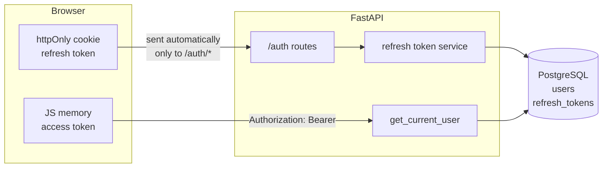

The access token is checked **without** a database lookup of the token itself (only its signature and expiry). The refresh token is checked **against the database**, which is what makes revocation possible.

---

## 2. Token types

| | Access token | Refresh token |
|---|---|---|
| Format | JWT, signed with HS256 | Opaque random string (`secrets.token_urlsafe(32)`, 43 chars) |
| Lifetime | 15 minutes | 7 days |
| Returned in | Response body of `/auth/login` and `/auth/refresh` | `Set-Cookie` header |
| Stored by the client in | JavaScript memory (never `localStorage`) | httpOnly cookie, `Path=/auth` |
| Sent as | `Authorization: Bearer <token>` | Cookie, automatically by the browser |
| Stored by the server | Not stored | SHA-256 hash in `refresh_tokens` |
| Verified by | Signature + `exp` + `type == "access"` | Hash lookup + not revoked + not expired |
| Can be revoked early | No (expires on its own) | Yes |

Access token payload:

```json
{ "sub": "1", "type": "access", "exp": 1792094420 }
```

- `sub`: the user id, as a string (required by the JWT spec)
- `type`: always `"access"`. Checked on every decode so other token kinds can never be used as access tokens.
- `exp`: expiry as a Unix timestamp. PyJWT rejects expired tokens automatically.

> The JWT payload is **signed, not encrypted**. Anyone can read it. Never put secrets in it.

---

## 3. Flows

### 3.1 Signup

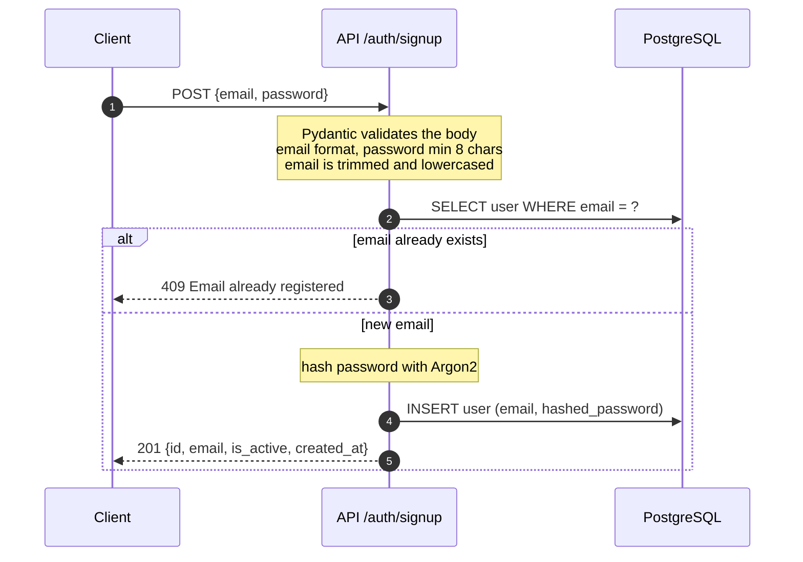

The response never includes the password or its hash: `response_model=UserRead` filters the output.

### 3.2 Login

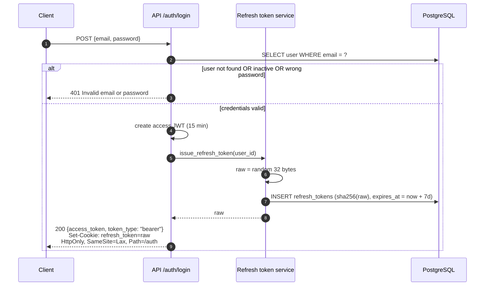

The same error message is used whether the email does not exist, the account is deactivated, or the password is wrong, so the endpoint cannot be used to discover registered or deactivated emails.

### 3.3 Calling a protected endpoint

Any route that declares `current_user: User = Depends(get_current_user)` is protected. `GET /auth/me` is the example.

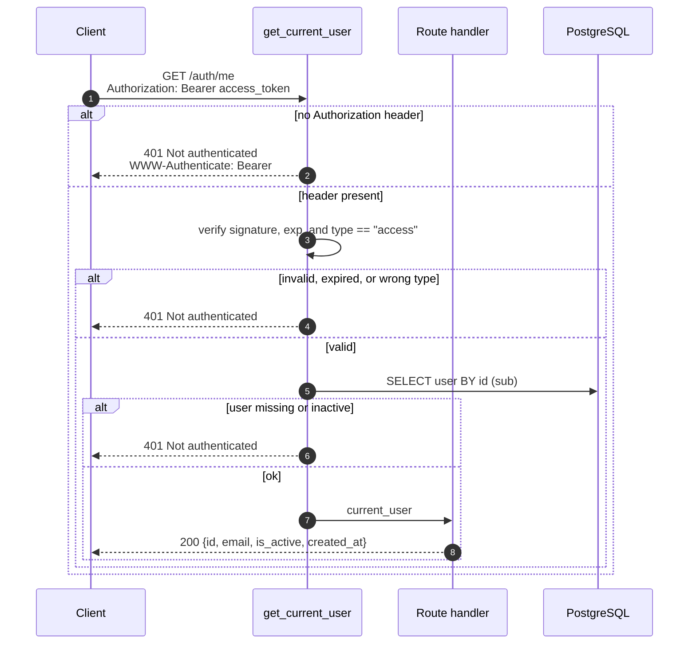

All failures return the same response, so a caller cannot tell *why* authentication failed.

### 3.4 Refresh with rotation

Called by the frontend when the access token has expired, or after a page reload (the in-memory access token is lost on reload).

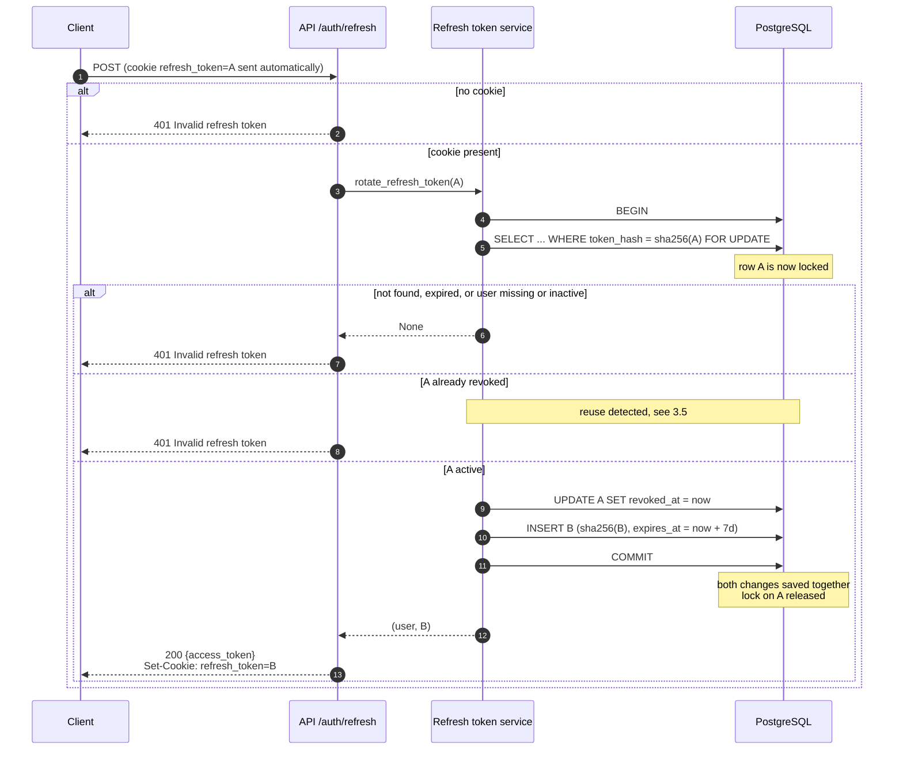

Each refresh token works **exactly once**. After a successful refresh the browser holds `B`, and `A` is permanently revoked.

### 3.5 Reuse detection (stolen token)

If an already-revoked refresh token is presented again, two parties hold copies of the same token, so one of them stole it. The server cannot tell which one is the real user, so it ends **all** of the user's sessions.

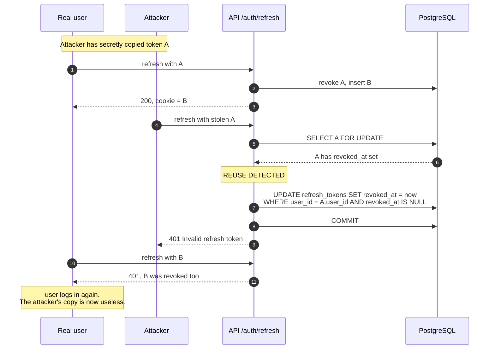

The same protection works if the attacker uses the token **first**: then the real user's later refresh with `A` triggers the detection.

### 3.6 Logout

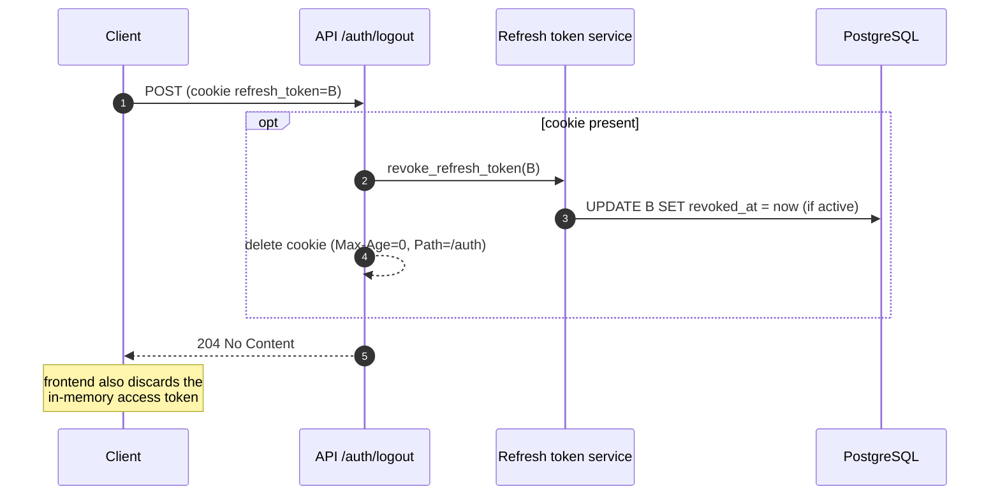

- Logout is **idempotent**: calling it twice, or without a cookie, still returns `204`.
- The refresh token is revoked **in the database**, so a copy of the cookie stops working too.
- The **access token is not revoked**. It stays valid until it expires (at most 15 minutes). See [limitations](#10-known-limitations-and-next-steps).

---

## 4. Concurrency: transaction and row lock

Rotation makes two changes (revoke the old token, insert the new one). Two mechanisms keep this safe.

### Transaction: all or nothing

Both changes are committed with a single `db.commit()`. If anything fails before the commit, nothing is saved: the old token stays valid and the client can retry. Without this, a crash between the two writes could revoke the old token without creating a new one, logging the user out for no reason.

### Row lock: one winner per token

`SELECT ... FOR UPDATE` locks the token's row until the transaction commits. This matters when two requests use the **same** token at the same moment.

**Without the lock**, both requests read the token as active and both succeed. One token forks into two valid tokens, and reuse detection never fires:

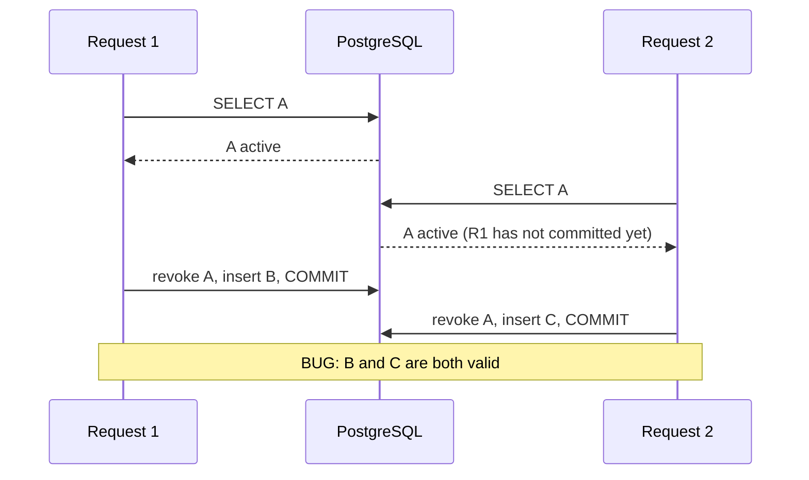

**With the lock**, the second request waits, then sees the committed result:

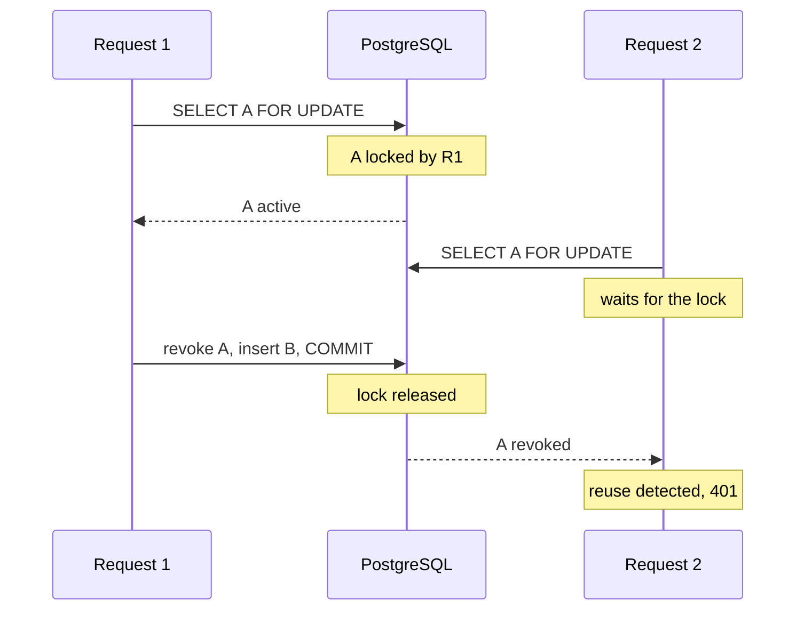

**Side effect:** two browser tabs refreshing at the same time is innocent, but it looks exactly like this race, so the second tab triggers reuse detection and logs the user out. The frontend prevents this with a **single-flight refresh**: only one refresh request is in flight at a time, and other requests wait for its result.

---

## 5. Refresh token lifecycle

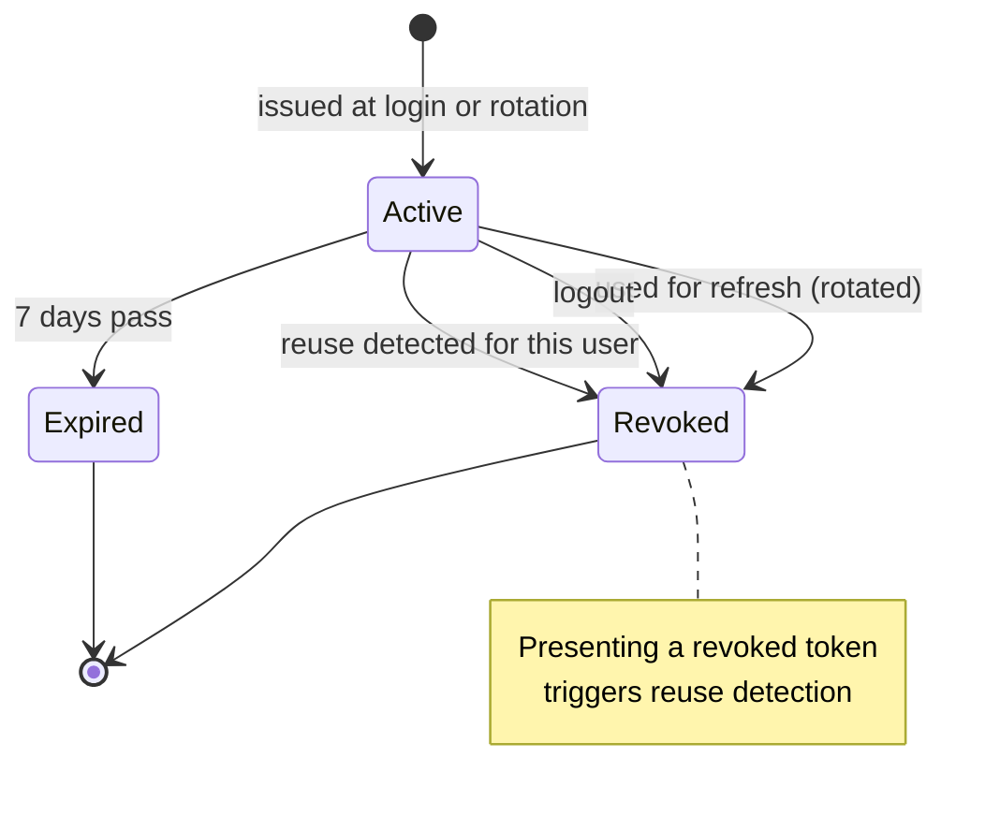

A token is usable only in the **Active** state: its row exists, `revoked_at IS NULL`, and `expires_at > now`.

---

## 6. Data model

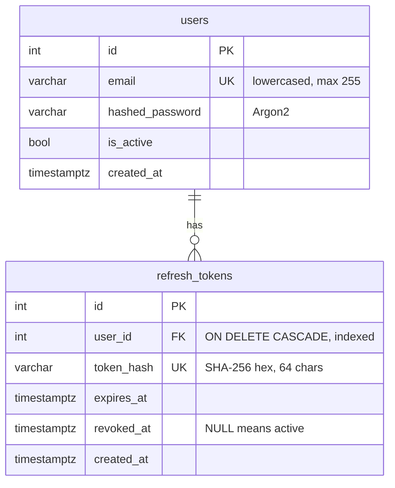

- Revoked tokens are kept (not deleted) so there is an audit trail and so reuse can be detected.
- Deleting a user deletes their refresh tokens (`ON DELETE CASCADE`).
- All timestamps are `timestamptz` and all Python times are created with `datetime.now(timezone.utc)`.

Migrations live in `backend/alembic/versions/`:

| Revision | Description |
|---|---|
| `aa92e4eac238` | create `users` |
| `061bcebea4fd` | create `refresh_tokens` |

---

## 7. API reference

All routes are under `/auth`.

| Method | Path | Auth | Request | Success | Errors |
|---|---|---|---|---|---|
| `POST` | `/auth/signup` | none | `{"email", "password"}` | `201` user | `409` email taken, `422` invalid body |
| `POST` | `/auth/login` | none | `{"email", "password"}` | `200` `{"access_token", "token_type"}` + refresh cookie | `401` invalid credentials or inactive account, `422` invalid body |
| `POST` | `/auth/refresh` | refresh cookie | none | `200` `{"access_token", "token_type"}` + rotated cookie | `401` invalid refresh token |
| `GET` | `/auth/me` | Bearer access token | none | `200` user | `401` not authenticated |
| `POST` | `/auth/logout` | refresh cookie (optional) | none | `204`, cookie cleared | none |

User object returned by `signup` and `me`:

```json
{
  "id": 1,
  "email": "test@example.com",
  "is_active": true,
  "created_at": "2026-10-15T11:22:17.637228Z"
}
```

Validation rules:

- `email` must be a valid address. It is trimmed and lowercased before use, so `" Test@Example.COM "` and `test@example.com` are the same account.
- `password` must be at least 8 characters at signup. Login does not apply length rules.

Interactive docs are available at `http://localhost:8000/docs`. Use the **Authorize** button to paste an access token.

---

## 8. Configuration

Settings are read from environment variables (or `backend/.env`) by `app/core/config.py`.

| Variable | Default | Purpose |
|---|---|---|
| `DATABASE_URL` | required | PostgreSQL connection string |
| `SECRET_KEY` | required | Signs access tokens. Generate with `openssl rand -hex 32`. Never commit it. |
| `JWT_ALGORITHM` | `HS256` | JWT signing algorithm |
| `ACCESS_TOKEN_EXPIRE_MINUTES` | `15` | Access token lifetime |
| `REFRESH_TOKEN_EXPIRE_DAYS` | `7` | Refresh token and cookie lifetime |
| `COOKIE_SECURE` | `false` | Adds the `Secure` flag to the refresh cookie. **Must be `true` in production** (HTTPS). |

---

## 9. Security decisions

| Decision | Why |
|---|---|
| Passwords hashed with **Argon2** | Slow and salted, so leaked hashes are expensive to brute-force. Current OWASP recommendation. |
| Refresh tokens hashed with **SHA-256** (not Argon2) | Tokens are 256-bit random values and cannot be guessed, so a fast hash is safe. Being unsalted keeps them searchable by hash. |
| Access token **in memory**, not `localStorage` | `localStorage` is readable by any injected script (XSS). Memory is lost on reload, which is handled by calling `/auth/refresh`. |
| Refresh token in an **httpOnly** cookie | JavaScript cannot read it, even during an XSS attack. |
| Cookie **`SameSite=Lax`** | The browser does not send it on cross-site sub-requests, blocking most CSRF. |
| Cookie **`Path=/auth`** | The long-lived token is only sent to auth endpoints, never with ordinary API calls. |
| Cookie **`Secure`** in production | Never sent over unencrypted HTTP. Driven by config so it cannot be forgotten in code. |
| **Short** access token lifetime (15 min) | Limits the damage of a leaked access token, since access tokens cannot be revoked. |
| **`type` claim** in the JWT | Prevents any other token kind from being accepted as an access token. |
| **Opaque** refresh tokens | The database is the source of truth, so a JWT adds nothing and would expose data. |
| **Rotation** on every refresh | Each refresh token works once, which limits the window for a stolen token. |
| **Reuse detection** | A second use of a revoked token signals theft, so all of the user's sessions are revoked. |
| **`SELECT ... FOR UPDATE`** + single commit | Prevents concurrent requests from forking one token into two, and keeps rotation atomic. |
| **Identical error messages** for all auth failures | Callers cannot learn whether an email exists or why a token was rejected. |
| **`is_active` checked everywhere** (login, refresh, every protected request) | Deactivating a user blocks new logins immediately and existing sessions within 15 minutes (when the access token expires). |
| `WWW-Authenticate: Bearer` on `401` | Required by the HTTP spec (RFC 9110) for 401 responses. |
| Emails **normalized** on input | Prevents duplicate accounts that differ only in case or whitespace. |

---

## 10. Known limitations and next steps

| Item | Impact | Plan |
|---|---|---|
| Access tokens cannot be revoked | After logout or reuse detection, an already-issued access token works until it expires (max 15 min). | Accepted trade-off of stateless JWTs. Keep the lifetime short. |
| No absolute session timeout | Each rotation issues a token valid for 7 more days (sliding expiration), so an active session never ends. A thief on an abandoned session can keep it alive indefinitely by following the rotation chain. | Step 3d-3: add `session_expires_at` (30 days from login, inherited on rotation) and cap each token's `expires_at` at it. Cookie `max_age` must follow the capped expiry. Use an add-nullable, backfill, then NOT NULL migration. |
| Multi-tab refresh race | Two tabs refreshing at once trigger reuse detection and log the user out. | Single-flight refresh in the frontend Axios interceptor. |
| Expired and revoked tokens are never deleted | `refresh_tokens` grows forever. | Scheduled cleanup job, e.g. delete rows expired for more than 30 days. |
| No rate limiting on `/auth/login` | Passwords can be brute-forced online. | Add rate limiting per IP and per account. |
| Errors use FastAPI's default `{"detail": ...}` shape | Inconsistent error format for clients. | Step 3e: RFC 9457 Problem Details. |
| No "log out of all devices" endpoint | Users cannot end other sessions themselves. | Reuse the bulk revoke query behind a new endpoint. |
| No CORS configuration | The React dev server cannot call the API yet. | Configure CORS with `allow_credentials=True` when the frontend is added. |
| No automated tests | Regressions are only caught manually. | Add pytest tests for every flow in this document. |

---

## 11. Code map

| File | Responsibility |
|---|---|
| `backend/app/api/auth.py` | HTTP layer: `/auth` routes, cookie handling |
| `backend/app/api/deps.py` | `get_current_user` dependency (Bearer token) |
| `backend/app/services/refresh_tokens.py` | Issue, rotate (with reuse detection), and revoke refresh tokens |
| `backend/app/core/security.py` | Password hashing, access token creation and decoding, refresh token generation and hashing |
| `backend/app/core/config.py` | Settings from environment variables |
| `backend/app/models/user.py` | `users` table |
| `backend/app/models/refresh_token.py` | `refresh_tokens` table |
| `backend/app/schemas/user.py` | Request and response schemas for users |
| `backend/app/schemas/token.py` | `Token` response schema |
